# 認証まわりの仕様と動作

Hagoromo のアカウント認証(アプリパスワード / OAuth)について、クラスの役割、処理の流れ、セッションの状態管理をまとめる。

- 対象: Hagoromo の開発者
- 図は Mermaid で記述している(GitHub 上で表示される)

## 目次

1. [認証方式](#1-認証方式)
2. [クラス構成と役割](#2-クラス構成と役割)
3. [OAuth のログイン](#3-oauth-のログイン)
4. [リクエストの送信](#4-リクエストの送信)
5. [セッションの維持(リフレッシュ)](#5-セッションの維持リフレッシュ)
6. [失敗が確定しているときに送信しない仕組み](#6-失敗が確定しているときに送信しない仕組み)
7. [アプリパスワードのセッション](#7-アプリパスワードのセッション)
8. [起動時の読み込みと保存](#8-起動時の読み込みと保存)
9. [エラー通知と UI への反映](#9-エラー通知と-ui-への反映)
10. [タイミング・定数一覧](#10-タイミング定数一覧)
11. [テスト](#11-テスト)

---

## 1. 認証方式

アカウントごとに `AccountData::auth_type` で方式を持つ。

| 項目 | アプリパスワード (`AuthType::Password`) | OAuth (`AuthType::OAuth`) |
|---|---|---|
| ログイン | `com.atproto.server.createSession`(ID / パスワード、必要なら 2FA のトークン) | ブラウザでの認可(PAR + PKCE + DPoP) |
| Authorization ヘッダー | `Bearer <accessJwt>` | `DPoP <access_token>` + `DPoP: <proof>` |
| リフレッシュ | `com.atproto.server.refreshSession`(`Bearer <refreshJwt>`) | token エンドポイントに `grant_type=refresh_token` |
| リフレッシュ失敗時 | 保存したパスワードで `createSession` し直せる(起動時のみ) | 作り直せないので再ログインが必要 |
| 保存するもの | パスワード、refreshJwt(暗号化) | refresh token、DPoP の秘密鍵(暗号化)、各エンドポイント、scope |
| DM の可否 | アクセストークン(JWT)の `scope` が `com.atproto.appPassPrivileged` | token のレスポンスの `scope` に chat.bsky が含まれる |

`accessJwt` / `refreshJwt` というフィールド名は、OAuth のアカウントでもそれぞれ access token / refresh token の保存に使う。

---

## 2. クラス構成と役割

### 2.1 全体の構成

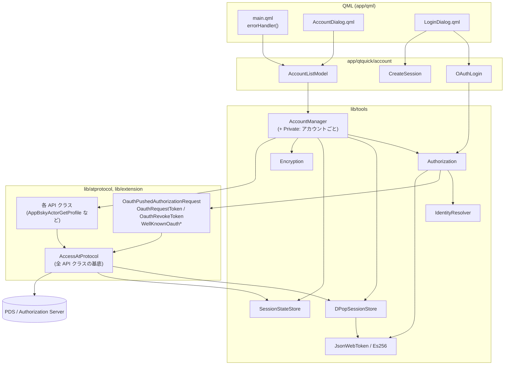

`lib/atprotocol`(`AccessAtProtocol`)は `AccountManager` を参照しない。
送信時に必要なアカウントの状態は、uuid をキーにしたシングルトン(`DPopSessionStore` / `SessionStateStore`)から引く。

### 2.2 クラスの役割

| クラス | 場所 | 役割 |
|---|---|---|
| `AccountManager` | `lib/tools/accountmanager.*` | アカウント一覧の保持・保存・読み込み、セッションの作成・リフレッシュ・失効の管理(シングルトン)。アカウントごとの処理は内部クラス `AccountManager::Private` が持つ |
| `AccountListModel` | `app/qtquick/account/accountlistmodel.*` | `AccountManager` を QML に公開する Model。`updatedAccount` を受けて `dataChanged` を出す |
| `OAuthLogin` | `app/qtquick/account/oauthlogin.*` | QML からの OAuth ログイン。`Authorization` を動かし、結果を `OAuthSession` にまとめる |
| `CreateSession` | `app/qtquick/account/createsession.*` | QML からのアプリパスワードでのログイン |
| `Authorization` | `lib/tools/authorization.*` | OAuth のシーケンス本体(サーバーの探索、PAR、リダイレクトの受信、token の取得・リフレッシュ、失効) |
| `IdentityResolver` | `lib/tools/identityresolver.*` | ハンドル / DID から DID・ハンドル・PDS を双方向に検証しながら解決する |
| `DPopSessionStore` | `lib/tools/dpopsessionstore.*` | OAuth アカウントごとの DPoP の秘密鍵と、送信先 origin ごとの nonce を保持し、DPoP proof を作る |
| `SessionStateStore` | `lib/tools/sessionstatestore.*` | アカウントごとのセッションの状態(再ログインが必要か、アクセストークンの期限)を保持し、リフレッシュの依頼を中継する |
| `AccessAtProtocol` | `lib/atprotocol/accessatprotocol.*` | すべての API クラスの基底。Authorization ヘッダーの付与、送信前の確認、DPoP の nonce による再送 |
| `JsonWebToken` / `Es256` | `lib/tools/jsonwebtoken.*`, `es256.*` | DPoP proof(ES256 の JWT)の生成、鍵の生成・PEM の読み書き |
| `Encryption` | `lib/tools/encryption.*` | 保存するパスワード・refresh token・秘密鍵の暗号化 |

### 2.3 アカウントの情報の持ち方

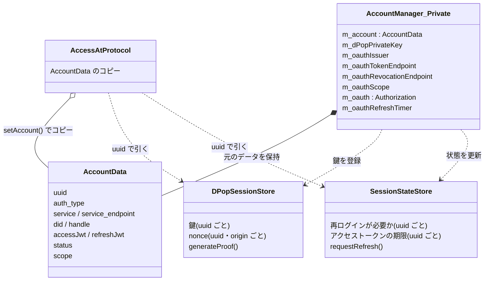

- `AccountData` は API クラスに **コピー** して渡す(`setAccount()`)。モデルなどが保持しているコピーは古くなることがある。
- DPoP の秘密鍵は `AccountData` に入れない(リクエストごとにコピーされないようにする)。`DPopSessionStore` に uuid で登録する。
- 送信の可否は `AccountData::status` ではなく、送信直前に `SessionStateStore` を uuid で引いて判断する([6章](#6-失敗が確定しているときに送信しない仕組み))。

---

## 3. OAuth のログイン

### 3.1 シーケンス

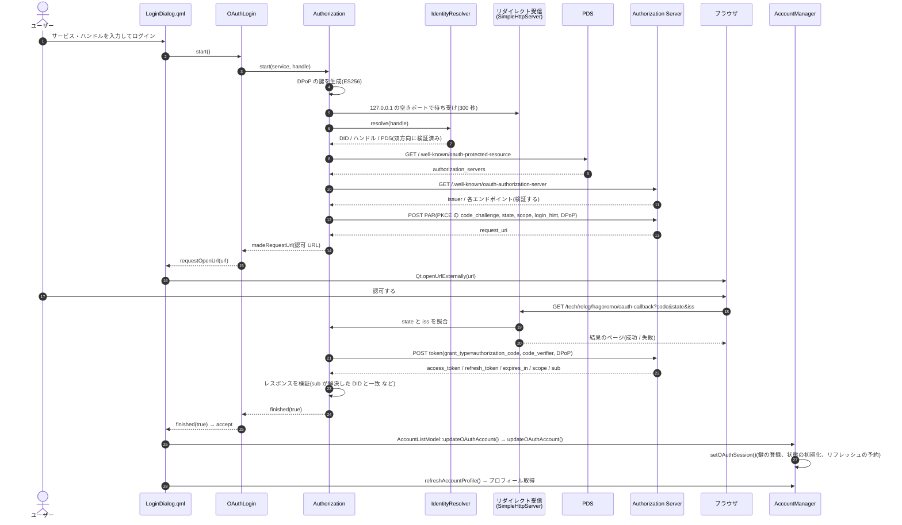

### 3.2 主な仕様

- **クライアント**: `client_id` は `https://oauth.hagoromo.relog.tech/oauth-client-metadata.json`、`redirect_uri` は `http://127.0.0.1:<port>/tech/relog/hagoromo/oauth-callback`。
- **scope**: `Authorization::defaultScopes()`。`oauth-client-metadata.json` の scope と同じ文字列で宣言されている必要がある。
- **DPoP の鍵**: ログインのたびに新しく生成する。token は鍵に紐づくため、以後のリフレッシュ・API アクセス・失効はすべて同じ鍵で行う。
- **DPoP の nonce**: PAR / token / revoke で `use_dpop_nonce` が返ったら、新しい nonce で 1 回だけ再送する。
- **リダイレクトの検証**: `state` が PAR で送ったものと一致し、`iss` がメタデータの `issuer` と一致する場合だけ token を取得する。
- **token のレスポンスの検証**(`validateTokenResponse()`): `access_token` / `refresh_token` があること、`token_type` が DPoP、`scope` に `atproto` を含むこと、`sub` が DID で、解決した DID と一致すること。
- **同じ DID のアカウント**: uuid を引き継いで置き換える(パスワード方式からの切り替えを含む)。以前の OAuth セッションの refresh token と異なる場合は、以前のセッションを失効させる。
- **ログ**: 認可コード、token、code_verifier、パスワードはログに出さない。

---

## 4. リクエストの送信

### 4.1 送信処理の流れ

`AccessAtProtocol::get()` / `post()` / `postWithImage()` は、認証ヘッダーを付ける場合に次の順で処理する。

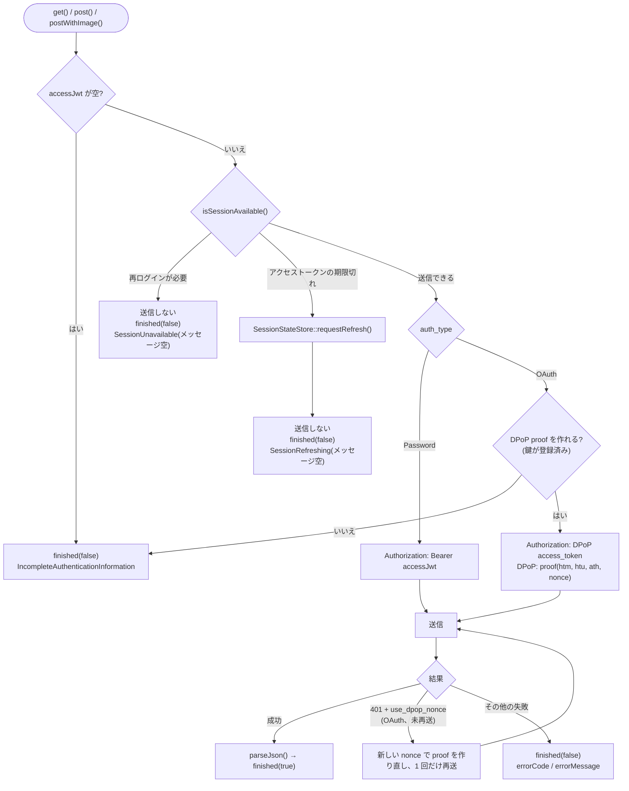

- `with_auth_header=false` のリクエスト(PAR / token / revoke、well-known など)は確認の対象外。
- DPoP の nonce はレスポンスの `DPoP-Nonce` ヘッダーから、uuid と送信先の origin ごとに `DPopSessionStore` に保存し、次の proof で使う。
- 送信前に失敗する場合は、既存の空 `accessJwt` のチェックと同じく、呼び出しの中で同期的に `finished(false)` を出す。

---

## 5. セッションの維持(リフレッシュ)

### 5.1 OAuth のリフレッシュのきっかけ

OAuth のリフレッシュ(`AccountManager::Private::refreshOAuthSession()`)は、次の 4 つから呼ばれる。

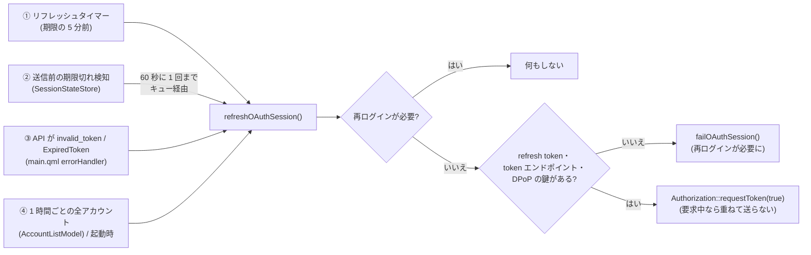

refresh token は使い捨てなので、同時に 2 つ送ると片方が失敗してセッションを失う。
アカウントごとに 1 つの `Authorization` を使い回し、`m_tokenRequesting` で token の要求を排他している。

### 5.2 リフレッシュの結果

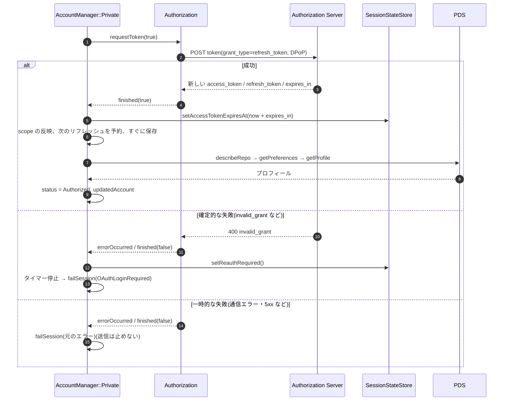

- 新しい refresh token を受け取ったら、古いものは使えなくなるので **すぐに保存** する。
- 失敗の分類は `AccountManager::Private::isOAuthReauthRequiredError()` で行う。

| 分類 | エラーコード | 動作 |
|---|---|---|
| 確定的な失敗 | `invalid_grant`, `invalid_client`, `unauthorized_client`, `unsupported_grant_type`, `invalid_request`, `invalid_scope`, `Invalid DPoP key`, `Invalid token response`、および送信前の不足(refresh token・エンドポイント・鍵がない) | 再ログインが必要な状態にする。通知は `OAuthLoginRequired` |
| 一時的な失敗 | 上記以外(`Unknown`, `Other`, `use_dpop_nonce` の再送失敗、5xx など) | 状態は変えない。通知は元のエラー |

`Invalid token response` は、サーバーは新しい token を発行した(古い refresh token は使用済み)が、検証で受け入れなかったケースなので確定的な失敗として扱う。

---

## 6. 失敗が確定しているときに送信しない仕組み

OAuth のセッションが切れた後、再ログインするまで「必ず失敗するリクエスト → リフレッシュ → 失敗 → 通知」が繰り返されないようにする。

### 6.1 SessionStateStore

アカウントの uuid をキーに、次の状態を保持する(スレッドセーフ、シングルトン)。

| 状態 | 設定 | 解除 |
|---|---|---|
| 再ログインが必要 | リフレッシュの確定的な失敗(`failOAuthSession()`) | 再ログイン(`setOAuthSession()`)、パスワード方式への切り替え(`clearOAuthSession()`)、アカウントの削除・`clear()`(`~Private`) |
| アクセストークンの期限 | ログイン時・リフレッシュ成功時に `now + expires_in`(`expires_in` がなければ記録しない) | 上と同じ |
| リフレッシュの依頼時刻 | `requestRefresh()` | 新しい期限の設定時 |

- 期限の 10 秒前から期限切れとして扱う(発行から受信までの時間差を見込む)。
- 期限が分からないアカウントは期限切れとして扱わない(パスワード方式、起動直後で最初のリフレッシュ前の OAuth)。
- 期限は実際の時刻(UTC)で比べるので、スリープをはさんでも正しく判定できる。

### 6.2 OAuth アカウントの状態遷移

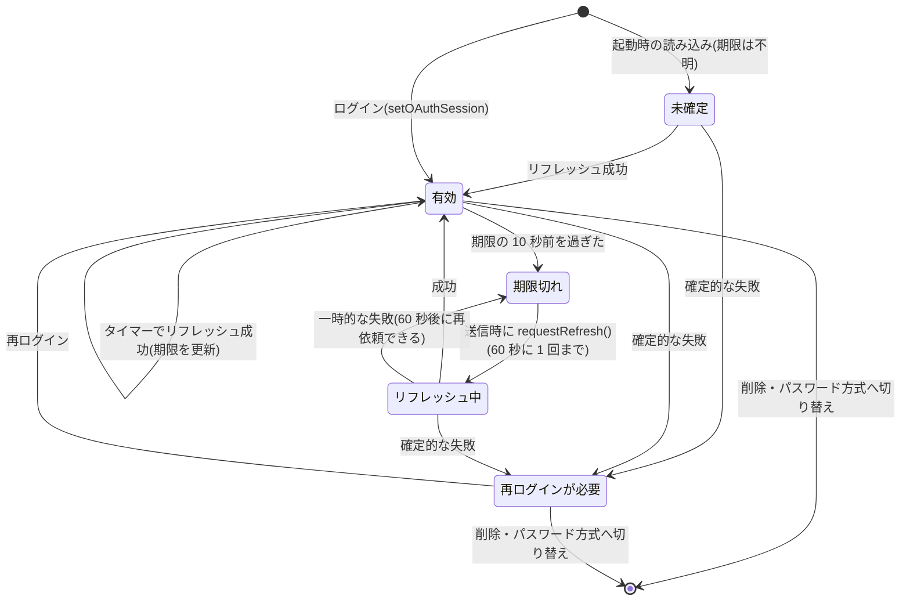

| 状態 | 送信 | リフレッシュ |
|---|---|---|
| 未確定 / 有効 | 送る | タイマー、`invalid_token` などで行う |
| 期限切れ / リフレッシュ中 | 送らない(`SessionRefreshing`) | 送信時に 1 回だけ依頼する |
| 再ログインが必要 | 送らない(`SessionUnavailable`) | 行わない(token エンドポイントにも送らない) |

### 6.3 リフレッシュの依頼の中継

`AccessAtProtocol` は `AccountManager` を参照できないため、`SessionStateStore` に登録したコールバックで依頼する。

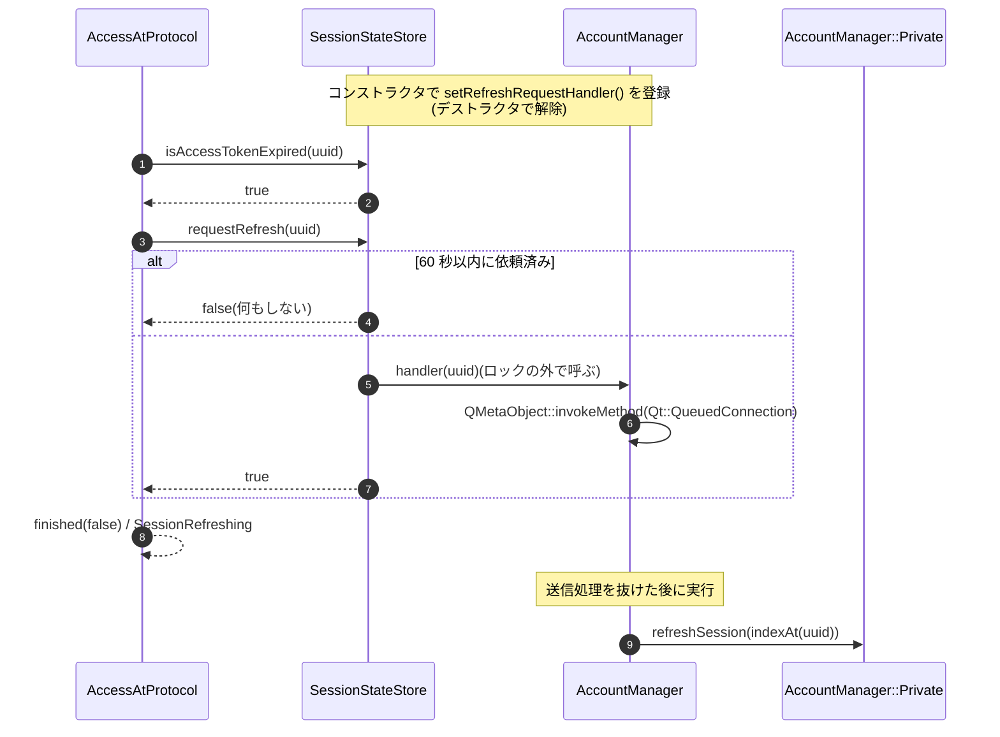

- 送信処理の途中や別スレッドから呼ばれることがあるため、リフレッシュはキュー経由で後から実行する。
- 止めたリクエストは送り直さない。カラムは次の定期更新で取得し直す。

---

## 7. アプリパスワードのセッション

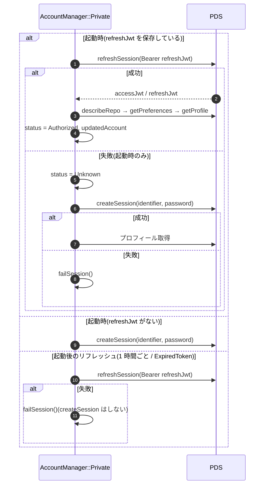

- アプリパスワードのアカウントには、アクセストークンの期限による送信停止([6章](#6-失敗が確定しているときに送信しない仕組み))は適用されない(期限を記録しない)。
- API が `ExpiredToken` を返すと、`main.qml` の `errorHandler` がリフレッシュを依頼する。
- ログインダイアログでのログインは `CreateSession`(QML 用)が行い、2FA のトークン(`authFactorToken`)にも対応する。

---

## 8. 起動時の読み込みと保存

### 8.1 起動時

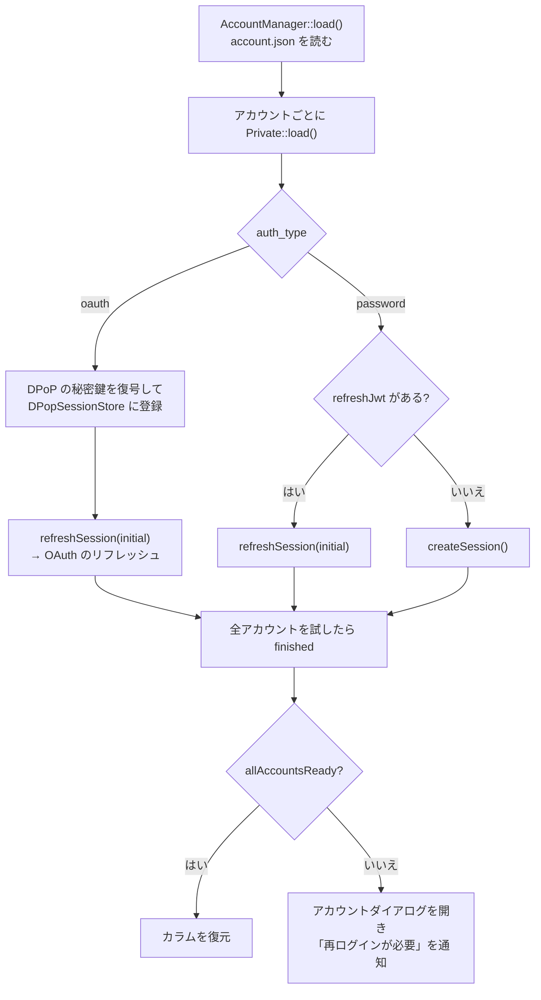

- 起動時は、再ログインが必要かどうかやアクセストークンの期限が分からない。最初のリフレッシュの結果で決まる。

### 8.2 保存内容(`account.json`)

| キー | 内容 | 暗号化 |
|---|---|---|
| `uuid`, `is_main`, `service`, `identifier` | 共通 | なし |
| `password` | アプリパスワード | あり |
| `refresh_jwt` | refresh token(両方式) | あり |
| `auth_type` | `"password"` / `"oauth"` | なし |
| `did`, `handle`, `service_endpoint` | OAuth のみ | なし |
| `oauth.issuer`, `oauth.token_endpoint`, `oauth.revocation_endpoint`, `oauth.scope` | OAuth のみ | なし |
| `oauth.dpop_private_key` | DPoP の秘密鍵(PEM) | あり |

- access token は保存しない(起動時にリフレッシュで取得する)。
- `SessionStateStore` の状態は保存しない。

### 8.3 失効(revoke)

次の場合に、使わなくなる OAuth セッションの refresh token をサーバー側でも失効させる(`revokeOAuthSession()`)。失効に失敗してもアカウントの操作は続ける。

- 同じアカウントでログインし直したとき(以前の refresh token と異なる場合)
- パスワード方式に切り替えたとき
- アカウントを削除したとき

---

## 9. エラー通知と UI への反映

### 9.1 エラーコード

| errorCode | 発生元 | メッセージ | `main.qml` の `errorHandler` の動作 |
|---|---|---|---|
| `SessionUnavailable` | `AccessAtProtocol`(再ログインが必要) | 空 | 何もしない |
| `SessionRefreshing` | `AccessAtProtocol`(期限切れ) | 空 | 何もしない |
| `ExpiredToken` / `invalid_token` | PDS | あり | そのアカウントのリフレッシュを依頼(通知しない) |
| `OAuthLoginRequired` | `AccountManager`(再ログインが必要になった) | あり | 「再ログインしてください」の翻訳済み文言で通知 |
| `IncompleteAuthenticationInformation` | `AccessAtProtocol`(accessJwt が空、DPoP の鍵がない) | あり | 通知 |
| その他 | PDS / Authorization Server | あり | 通知 |

`errorHandler` は `message` が空のエラーを通知しない。送信前に止めたエラーはメッセージを空にして、通知が繰り返されないようにしている。
再ログインが必要になったことの通知は、状態が変わったときに `AccountManager` から 1 回だけ行う。

### 9.2 アカウント一覧への反映

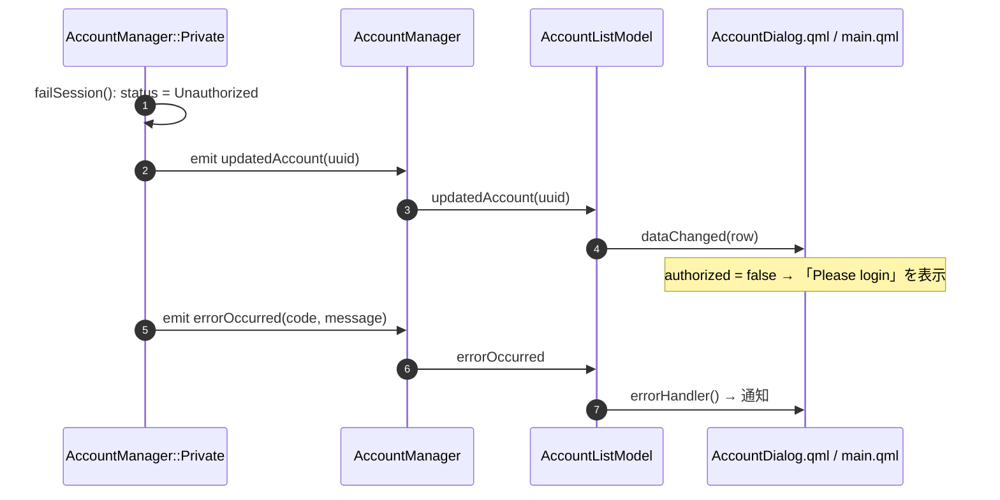

- `failSession()` は、失敗した場合も `updatedAccount` を出す。これがないと、アカウントダイアログの「Please login」の表示が更新されない。
- `AuthorizedRole` は `status == Authorized` のとき true。`AccessJwtRole` は `Authorized` のときだけ値を返す。

---

## 10. タイミング・定数一覧

| 項目 | 値 | 場所 |
|---|---|---|
| OAuth のリフレッシュタイマー | `expires_in` の 5 分前(最短 60 秒、`expires_in` がなければ 15 分) | `AccountManager::Private::scheduleOAuthRefresh()` |
| 期限切れとみなすマージン | 期限の 10 秒前 | `SessionStateStore`(`ACCESS_TOKEN_EXPIRATION_MARGIN_SEC`) |
| リフレッシュの依頼の間隔 | 60 秒に 1 回 | `SessionStateStore`(`REFRESH_REQUEST_INTERVAL_SEC`) |
| 全アカウントの定期リフレッシュ | 1 時間ごと | `AccountListModel` |
| ブラウザからのリダイレクト待ち | 300 秒 | `Authorization`(`m_redirectTimeout`) |
| DPoP の nonce による再送 | 1 回 | `AccessAtProtocol`, `Authorization` |

---

## 11. テスト

認証まわりのテストは主に `tests/oauth_test/tst_oauth_test.cpp` にある。モックサーバーは `DPopNonceServer`(`SimpleHttpServer` の派生)。

| テスト | 内容 |
|---|---|
| `test_oauth` / `test_oauth_process` | ログインのシーケンス、PAR・token のペイロード、リダイレクトの検証 |
| `test_oauth_dpop_nonce_retry_limit` | DPoP の nonce による再送が 1 回までであること |
| `test_oauth_token_validation` | token のレスポンスの検証 |
| `test_oauth_token_request_lock` | token の要求の排他 |
| `test_access_password` / `test_access_oauth` | Authorization ヘッダー、DPoP proof、Resource Server の nonce による再送 |
| `test_account_manager_oauth` | OAuth アカウントの追加・置き換え・リフレッシュ・再起動後の読み込み・失効、一時的な失敗と確定的な失敗の扱い、再ログインが必要な間と期限切れの間に送信しないこと、再ログイン・リフレッシュ後の再開、`updatedAccount` の通知 |
| `test_session_state_store` | 期限の判定、リフレッシュの依頼の間隔、状態の削除 |
| `test_oauth_revoke` | 失効のリクエスト |
| `test_no_secret_in_logs` | token・鍵などがログに出ないこと |

モックサーバーの `/oauth/token_invalid_grant` は、refresh token が無効なときの応答(400 `invalid_grant`)を返す。
